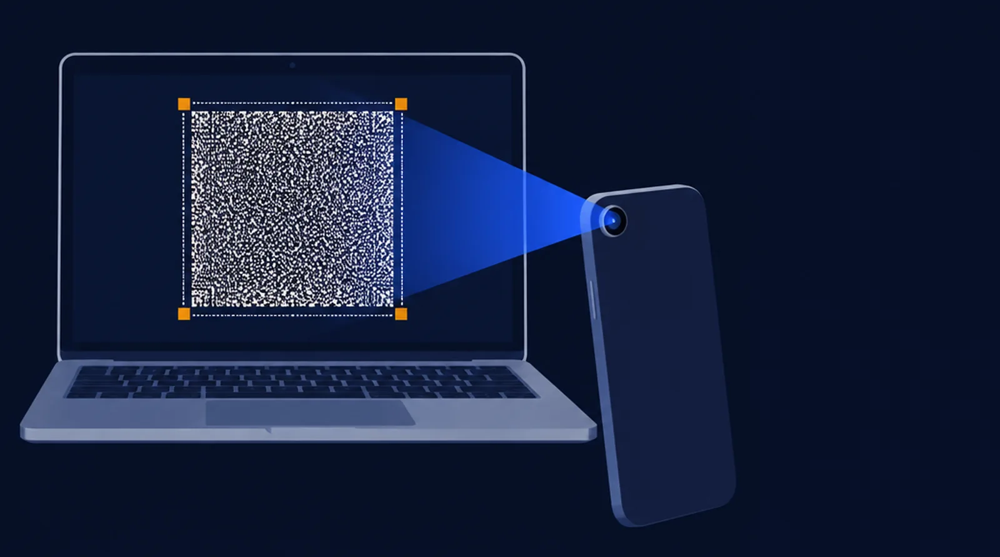
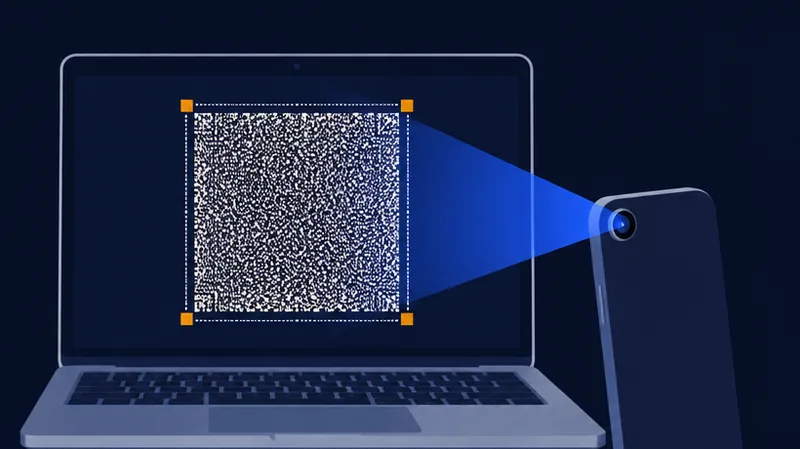
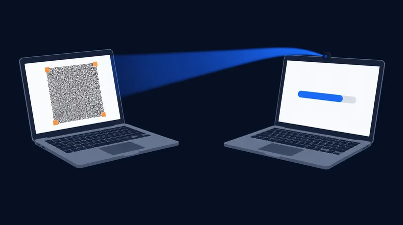
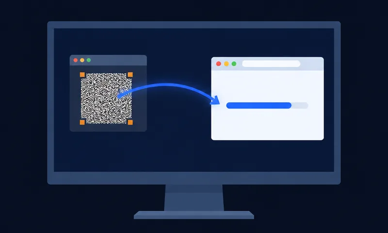

# LensBolt

Air-gapped file transfer from any screen to a phone camera. One-way, no cable, no network.

- `core/` — Rust codec and protocol (what exists today): frame format, Reed–Solomon with erasures,
  systematic fountain code, 16 MiB segments with SHA-256, blind sender scheduler, receiver, CLI.
- `android/` — the phone receiver app (CameraX + the Rust core over JNI).
- `web/` — the sender page (`index.html`) and the browser receiver (`receive.html`), the core compiled to
  WebAssembly. `web/dist/` holds single-file offline builds of both (`lensbolt.html`, `lensbolt-receive.html`):
  they run from a USB stick or `file://`, no server, no network.

One file or many: the sender takes several files as one transfer; a receiver keeps each file as it verifies,
to save from its row or all at once with Save all. Both ends show each file's SHA-256: the sender as it reads the file, the receiver
the hash it verified the file against, to compare by eye or copy.

## Three ways to receive

The sender is the same in each: open LensBolt on the computer that has the files, add them and press Start. The
receive page (or the Android app) then reads that screen one of three ways; nothing goes back to the sender.

| Phone camera | Webcam (PC to PC) | Share a window (one computer) |
|---|---|---|
|  |  |  |
| The phone reads the computer's screen: the Android app, or the receive page in the phone's browser (on iPhone, Receive in Safari). Hold it so the square fills most of the picture. | The receiving computer's camera reads the sending computer's screen. Choose Webcam on the receive page and turn the camera or the laptop until the square fills most of the picture. | The sender is in a window on the receiving computer (a VM, a remote desktop, or another computer's screen shared to this one). Choose Share a window and pick that window: no camera, nothing to hold. Choose Fastest on the sender. |

## Tests

`cd core && cargo test --release`; the app's JVM tests: `cd android && gradle testDebugUnitTest`. The capture gates
(`fhd2px_floor`, `phone_fhd2px_soft`, `split_read`, `phone_max1px`) read stored phone captures that are not in git:
without them those tests say so and pass. On a machine that keeps them, `LB_REQUIRE_CAPTURES=1` makes a missing
capture set fail instead.

## Licence and support

LensBolt is free software under the [GNU AGPL-3.0](LICENSE). If it helps you, you can support the work:
[Buy me a coffee](https://buymeacoffee.com/akhildara1l) · [GitHub Sponsors](https://github.com/sponsors/akhil-dara).

The project lives in three repositories: [lensbolt-core](https://github.com/akhil-dara/lensbolt-core) (the codec and
decoder, Rust), [lensbolt-web](https://github.com/akhil-dara/lensbolt-web) (the sender and receiver pages and the
site, lensbolt.com) and [lensbolt-android](https://github.com/akhil-dara/lensbolt-android) (the Android receiver).
